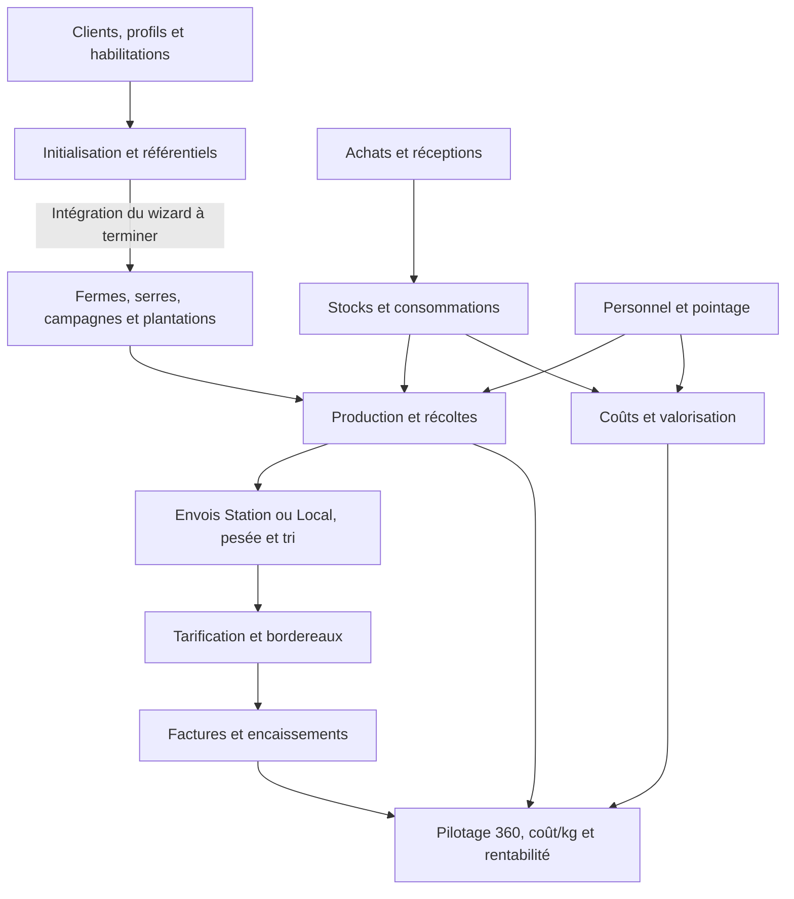

# Roadmap ItriX Farm

## Pilotage actualisé — 2 octobre 2026

Cette section prime sur le backlog historique ci-dessous. Un développement local ou un test simulé n'atteste ni son déploiement ni sa validation métier. Aucune publication Vercel, écriture métier distante ou migration n'est autorisée par cette mise à jour.

### Architecture fonctionnelle

Relations métier, pas une certification d'automatisation complète. Sources : `lib/navigation.tsx`, `app/recoltes/page.tsx`, `lib/stationSettlements.ts`, `app/admin/initialisation/page.tsx`.

### Ordre de livraison retenu

| Lot | Objectif | Statut | Critère de sortie |
|---|---|---|---|
| 1 | Fiabiliser récolte → envoi → tarification → facture → encaissement | En cours local | Rapprochement des kg et montants, cas partiels et retours, absence de doublons, droits et corrections recettés |
| 2 | Fiabiliser coûts et rentabilité | À réaliser / consolider | Chaque coût/kg expliqué par ses écritures ; CA tarifé, facturé et encaissé distingués ; devises explicites |
| 3 | Intégrer effectivement les dossiers du wizard | À réaliser | Précontrôle serveur, intégration idempotente par étape, journal et reprise après erreur |
| 4 | Recetter les parcours par profil | À valider | Chef d'exploitation, phyto, magasinier et administratif ; droits et notifications sur téléphone réel |
| 5 | Achever l'harmonisation et le guide | En cours local | Parcours prioritaires cohérents et utilisables sur mobile, erreurs liées aux champs |
| 6 | Mesurer le POC | À cadrer avec les référents | Mesures initiales puis adoption, temps économisé, fiabilité et délai de tarification |
| 7 | Préparer la commercialisation | À cadrer | Offre, support, sauvegarde/restauration et installation reproductible |

Fertigation : travaux conservés, refonte suspendue selon décision utilisateur. Hors-ligne avancé, IoT et prédictions IA non prioritaires. Aucun délai de livraison engagé avant estimation.

### Lot 1 — Avancement et recette restante

- [x] Récapitulatif local des envois tarifés : historique complet, filtres indépendants, détails et export Excel (`components/harvest/PricedDispatchReport.tsx`).
- [x] Allocations validées comme source de tarification, sans addition du CA miroir du lot ; prix pondéré et totaux séparés par devise (`lib/pricedDispatches.ts`).
- [x] Tests ciblés : 8 tests unitaires (calculs et verrou UI), navigateur simulé (filtre destination, détail, téléchargement Excel et largeur mobile). Aucun envoi ou paiement réel effectué.
- [x] Boutons Éditer/Supprimer et sélection groupée neutralisés dans l'interface pour les récoltes liées à un envoi ; nouveau contrôle avant action (`lib/harvestEditLock.ts`, `app/recoltes/page.tsx`).
- [x] Migration 142 appliquée et recette confirmée par l'utilisateur le 2 octobre 2026. Tests SQL locaux documentés ; application distante déclarée par l'utilisateur, non réinspectée automatiquement.
- [x] Ajouter en local les factures explicitement liées dans le récapitulatif : dédoublonnage, facturé, encaissé enregistré et solde par facture ; export dans une feuille distincte. Pas de ventilation artificielle par lot, pas de reste à facturer calculé sur des liens historiques incomplets.
- [x] Préparer le remplacement de la logique destructive de `admin_bulk_delete_harvests` dans la migration 142, sans modifier rétroactivement 039 et sans suppression des envois/sources/orphelins.
- [ ] Préserver la mise à jour légitime de `actual_kg` par la pesée Station (migration 059). Ne pas poser un verrou UPDATE global qui casserait ce parcours.
- [ ] Recetter quantités estimées/réelles, envois partiels et groupés, rejets et retours, tarification directe et plusieurs bordereaux, annulation et nouvelle validation.
- [x] Préparer 143 et sa recette SQL locale : prix pondéré, annulation/revalidation sans doublons, refus si facture liée et ferme obligatoire. Non appliquée ; voir `docs/LOT_143_RECETTE_CHAINE_RECOLTES.md`.
- [ ] Rendre composition et tri transactionnels ; préserver les quantités estimées des sources lors des pesées partielles. Risques identifiés dans les écritures successives actuelles : lot 1 non clôturable avant correction.
- [ ] Recetter les factures et encaissements partiels, ainsi que les refus inter-clients ; génération de facture déjà présente dans `lib/stationSettlements.ts`, contrairement au backlog ancien.
- [ ] Validation métier sur un dossier de référence puis autorisation explicite de publication.

Le wizard reste un dossier de préparation : `app/admin/initialisation/page.tsx` ne réalise pas encore l'intégration des étapes dans les modules opérationnels. Le suivi du déploiement distant doit être vérifié séparément.

## Backlog historique — à réconcilier, pas un statut de livraison actuel

> Backlog des évolutions produit pour le pilotage de production agricole
> du Domaine BENHALIMA (tomates serres, Maroc).
>
> Format : **🔥 P1 (urgent)** · **⚡ P2 (important)** · **💡 P3 (nice-to-have)**

---

## 📦 MODULE TRI / DISPATCHES / RÉCOLTES

### ✅ P1 — Destination du rejet (freinte / écart) — **LIVRÉ V1 mai 2026**

Implémenté dans le sprint mai 2026. **V1 livrée** :

- [x] Migration 038 : colonne `destination_rejet` sur `harvest_lots`
  - 4 valeurs : `destruction` | `retour_stock` | `vente_industrie` | `dons`
- [x] Colonnes `rejet_qty_kg` et `parent_dispatch_id` pour audit
- [x] **Page Web `/recoltes`** — modal Tri étendu :
  - Affiche le détail Rejet (Brute − Acceptée)
  - Sélecteur visuel 4 cartes (icône + description)
  - Si `retour_stock` : message d'info qui prévient de la création du lot enfant
- [x] **Création automatique du `harvest_lot` enfant** `category='stock_retour'`
  - Numéro de lot `{ORIGINAL}-RETOUR`
  - `parent_dispatch_id` pointe vers le dispatch d'origine
  - `tri_status='pending'` (disponible pour ré-envoi)
- [x] **Nouvel onglet "🔄 Stock retour"** sur `/recoltes`
  - Liste des lots de retour disponibles
  - Boutons "✅ Renvoyé" et "🗑️ Détruit" pour marquer la consommation
- [x] **Bot Telegram** — étape après écart% :
  - Nouvelle étape `ask_destination_rejet` avec 4 boutons inline
  - i18n en 4 langues (FR / EN / AR classique / Darija arabe)
  - Création auto du stock_retour identique à la version Web
  - Message de confirmation enrichi avec mention du lot enfant créé

**V2 (à venir)** :

- [ ] Composition directe d'un nouvel envoi station depuis un lot stock_retour
- [ ] Mettre à jour le calcul du CA : `qty_rejet × prix_marche_secondaire`
  quand le retour est ré-envoyé
- [ ] Stats périodiques : "% rejets valorisés" comme KPI Dashboard CEO

**Impact estimé V1** : visibilité totale sur la destination du rejet,
audit trail complet. **Impact estimé V2** : +5-15% CA récupéré.

---

## 💰 MODULE FACTURATION & TARIFICATION STATION

### ✅ P1 — Bordereaux station (tarification hebdomadaire) — **LIVRÉ V1 juin 2026**

La station de conditionnement envoie chaque semaine un bordereau qui paye
les dispatches déjà triés. Un dispatch peut être tarifé partiellement sur
plusieurs bordereaux (split FIFO).

- [x] **Migration 040** — 3 nouvelles tables :
  - `station_settlements` (en-tête bordereau, 1 par semaine ISO)
  - `station_settlement_lines` (1 ligne par farm × market × variety)
  - `station_settlement_allocations` (FIFO sur N dispatches)
- [x] Code auto-généré format `SET-YYYY-Www` via trigger
- [x] Colonnes `qty_priced_kg` + `settlement_id` sur `harvest_lots`
- [x] Trigger de maintenance `total_amount` / `total_qty_kg`
- [x] **Migration 041** — RPC `admin_validate_station_settlement(uuid)` :
  - Algorithme FIFO (date_lot ASC) sur les dispatches `tri_status='tried'`
  - Met à jour `qty_priced_kg` + bascule `tri_status='priced'` quand lot soldé
  - Atomique (échoue si stock insuffisant)
  - RPC complémentaire `admin_unvalidate_station_settlement` pour revenir en arrière
- [x] **Helpers** `lib/stationSettlements.ts` :
  - `getUnpricedLotsSummary()` — stock dispo agrégé market × variety × farm
  - `buildMatrix()` — fusion stock + lignes existantes pour saisie
  - `createCurrentWeekSettlement()` — création idempotente par semaine ISO
- [x] **UI** nouveau sous-onglet "Bordereaux station" dans `/factures`
  - Liste des bordereaux (brouillon + validés)
  - Modal matrice market × variety × farm avec dispo / qty / prix
  - Validation des quantités vs stock dispo
  - Boutons Valider FIFO / Annuler validation
  - Vue en lecture seule pour bordereaux validés

**V2 (à venir)** :

- [ ] Génération d'une vraie `invoice` (facture client) à la validation
- [ ] Lien `harvest_lots ↔ invoices` pour suivi croisé prix payé / coût production
- [ ] Vue "Bordereaux en retard" (>2 semaines sans validation)
- [ ] Stats : prix moyen par variété par mois sur graphique

**Impact V1** : workflow officiel station ↔ exploitation tracé en base,
prêt pour audit. Plus de saisie ad-hoc dans Excel.

---

## 🤖 MODULE CHATBOT TELEGRAM

### ⚡ P2 — TTS (text-to-speech) pour les réponses du bot
Permettre aux ouvriers ne lisant pas de recevoir les confirmations en
audio (synthèse vocale via Google Cloud TTS ou ElevenLabs).

### ⚡ P2 — Intégration WhatsApp Business
En plus de Telegram, supporter WhatsApp via WhatsApp Business API.
Workflow identique mais via Twilio ou Meta API directe.

### 💡 P3 — Reconnaissance vocale offline (Vosk)
Pour les zones sans réseau stable, fallback de transcription locale
sur le téléphone via Vosk (modèles compacts arabe/français).

---

## 📊 DASHBOARD CEO & ANALYTIQUE

### ⚡ P2 — Bench mark inter-fermes automatique
Comparaison automatique des fermes sur indicateurs filière :
- kg/m² vs objectif
- Coût/kg produit
- % qualité Cat. 1
- Délai de rotation Plantation → 1ère récolte

### 💡 P3 — Prédiction du yield via ML
Modèle simple (régression) basé sur historique campagne, variété,
type de serre, mois de plantation → prédiction kg total.

### 💡 P3 — Alertes intelligentes proactives
Email/Telegram quotidien quand :
- Yield diverge de >20% vs prévision
- Stock intrants critique sous le seuil de sécurité
- Facture client en retard > 30j

---

## 🚜 MODULE PRODUCTION

### ⚡ P2 — Carnet de bord agronomique
Pour chaque plantation, log quotidien :
- EC / pH de l'eau d'irrigation
- T°C jour/nuit
- HR (humidité relative)
- Stade phéno (BBCH)
- Observations sanitaires (maladies, ravageurs)

### 💡 P3 — Intégration capteurs IoT
Si la ferme s'équipe : ingestion automatique des données capteurs
(stations météo, sondes substrat) via MQTT.

---

## 💰 MODULE FINANCE

### ⚡ P2 — Multi-devises (EUR / MAD / USD)
Tableau de bord avec conversion automatique au taux du jour.
Particulièrement utile pour le CA Export (EUR) vs charges locales (MAD).

### ⚡ P2 — Gestion des taxes export
TVA exonérée Export, droits de douane par destination, ATR/EUR.1.

### 💡 P3 — Forecasting cash flow rolling 90j
Vue glissante 90 jours encaissements prévus vs décaissements prévus.

---

## 👥 MODULE RH

### ⚡ P2 — Pointage par chatbot Telegram
Les ouvriers déclarent leur arrivée/départ via Telegram (au lieu
de la pointeuse physique).

### 💡 P3 — Calcul payroll automatique CNSS Maroc complet
Génération des bordereaux CNSS officiels (BDS) prêts pour soumission.

---

## 🛡️ ADMINISTRATION & SÉCURITÉ

### ⚡ P2 — Logs d'audit centralisés
Table `audit_logs` pour tracer qui a fait quoi (modifications
critiques : suppression campagne, changement de prix, etc.).

### ⚡ P2 — Export/Import de configuration complète
Permettre à un admin de sauvegarder/restaurer toute la config
métier (workflows, comptes comptables, paramètres) en JSON.

### 💡 P3 — Mode multi-tenant (multi-domaines agricoles)
Architecture qui permet à plusieurs domaines indépendants d'utiliser
la même instance avec isolation totale.

---

## 🎨 UX / UI

### ⚡ P2 — Mode mobile-first complet
Audit page par page pour assurer une bonne expérience sur smartphone
(actuellement plutôt tablet/desktop friendly).

### 💡 P3 — Thèmes personnalisables par utilisateur
Au-delà du dark/light, permettre des thèmes de couleur custom (utile
pour daltoniens ou préférences visuelles).

---

## 📅 HISTORIQUE DES SPRINTS RÉCENTS (mai 2026)

- ✅ Refonte UI complète + design system (Card / Badge / KPICard / DataTable)
- ✅ Module Plan de culture (Dashboard + Plan + Volumes + Gantt)
- ✅ Assistant IA + insights Dashboard CEO
- ✅ Bot Telegram multilingue (FR / Darija arabe / Arabe / EN)
- ✅ Export Excel formaté multi-onglets (Compte d'exploitation + Budgets)
- ✅ Page admin /demo-reset (Nuclear / Reset / Wizard / Générateur récoltes)
- ✅ Migration 036 (RPC admin défensives) + 037 (Reseed workflows)
- ✅ Générateur Commerce (dispatches + tri + prix + factures)
- ✅ Dashboard CEO aligné sur logique récoltes × prix variété
- ✅ Vue Budget Multi-fermes avec sous-totaux par ferme

---

*Dernière mise à jour : voir `git log ROADMAP.md` pour l'historique.*
